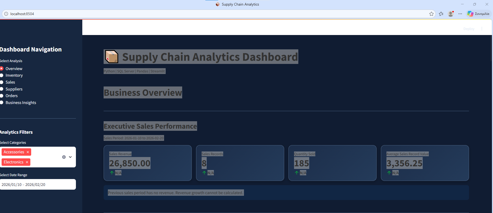
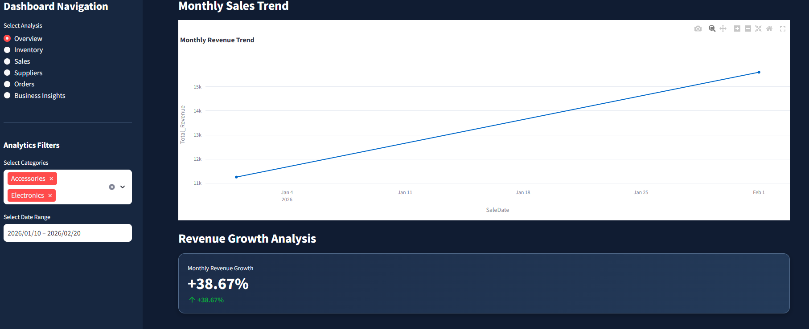
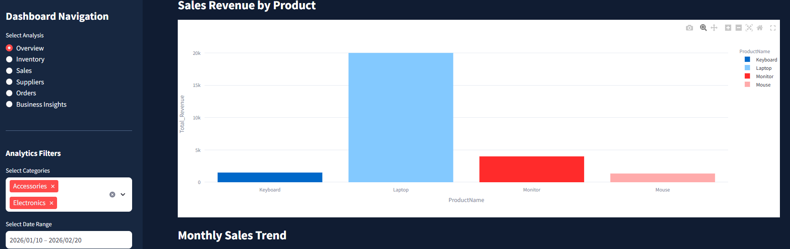
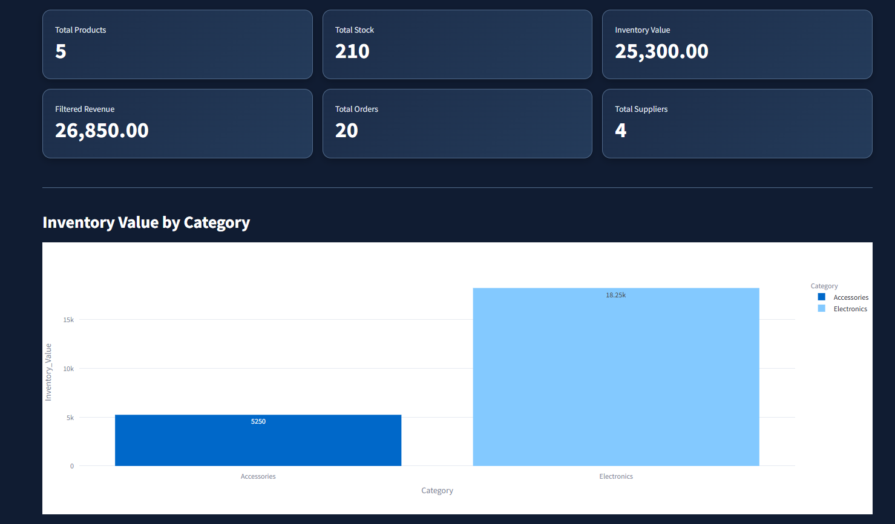
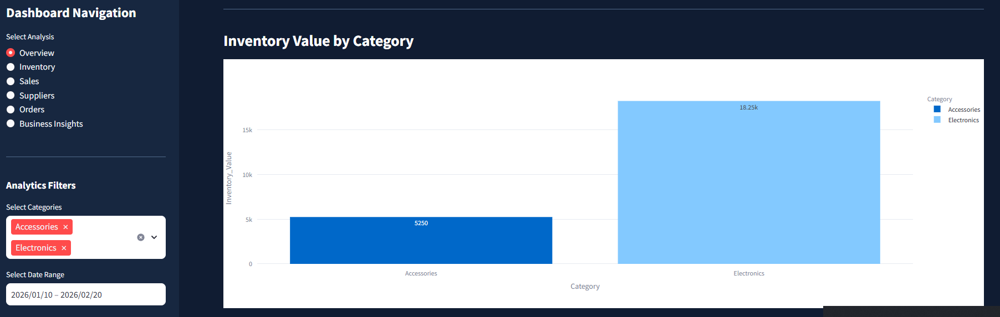
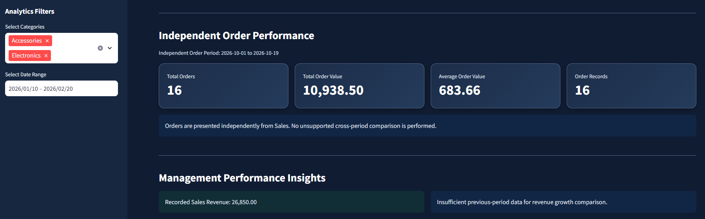
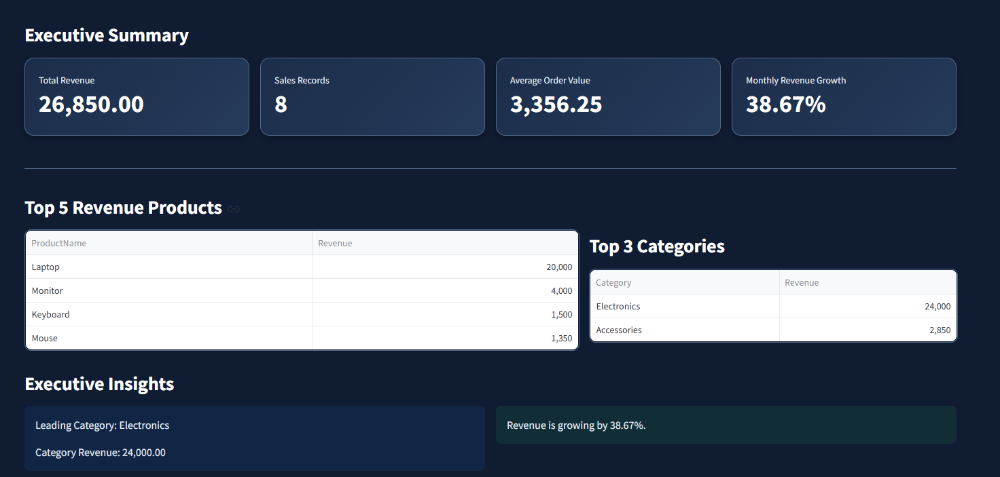

# Supply Chain Analytics Dashboard

An interactive Business Intelligence dashboard developed with Python to analyze supply chain operations, financial performance, inventory levels, supplier activity and order management.

The application transforms operational database records into meaningful business insights through interactive visualizations, KPI monitoring and analytical reporting.

## Dashboard Preview

## Dashboard Screenshots

## Dashboard Screenshots

### Executive Overview


### Sales Analysis




### Inventory Analysis




### Business Insights




## Business Objectives

The dashboard provides management with a centralized analytical tool for monitoring supply chain performance and supporting data-driven decisions.

Key objectives include:

- Monitoring financial performance and revenue trends.
- Evaluating product and category performance.
- Analyzing inventory levels and stock valuation.
- Monitoring supplier activity.
- Evaluating order performance.

## Technology Stack

- Python
- Microsoft SQL Server
- Pandas
- Streamlit
- Plotly
- SQLAlchemy
- OpenPyXL

## Key Features

### Executive Overview
- Executive Summary
- Financial Performance KPIs

### Sales Analytics
- Sales Revenue Analysis
- Revenue Contribution by Category
- Product Performance Analysis
- Monthly Revenue Trends
- Interactive Category and Date Filters

### Inventory Analytics
- Inventory Valuation
- Stock Monitoring

### Supplier Analytics
- Supplier Activity Analysis

### Order Analytics
- Independent Order Performance Analysis

### Reporting
- Interactive Plotly Visualizations
- Excel Report Export

## Technical Architecture

Microsoft SQL Server → SQLAlchemy → Pandas → Streamlit → Plotly

- SQL Server stores operational data.
- SQLAlchemy manages database connectivity.
- Pandas handles data processing and analysis.
- Streamlit provides the interactive dashboard interface.
- Plotly generates interactive visualizations.

## Project Structure

```text
SupplyChainAnalytics/
│
├── app.py
├── README.md
├── requirements.txt
├── .gitignore
│
├── screenshots/
│   ├── executive_overview.png
│   ├── inventory_analysis.png
│   ├── sales_analysis.png
│   └── business_insights.png
│
└── documentation/
    └── project_overview.md
```

## Installation & Setup

### 1. Install dependencies

```bash
pip install -r requirements.txt
```

### 2. Configure the database

Configure the Microsoft SQL Server connection in `app.py` according to your local environment.

A compatible Microsoft ODBC driver is required.

### 3. Run the application

```bash
streamlit run app.py
```

The dashboard will open in your default web browser.

## Business Value

The dashboard transforms operational data into actionable insights, supporting decisions related to:

- Revenue and financial performance.
- Inventory management.
- Product and category performance.
- Supplier activity.
- Order management.

## Future Improvements

- Automated data refresh.
- Demand forecasting.
- Inventory optimization.
- Supplier performance benchmarking.
- Cloud deployment.

## Project Status

Completed – Functional local application.

A configured SQL Server database connection is required to run the application.

## Author

Data Analytics & Business Intelligence Portfolio Project

